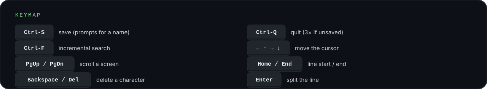

<p align="center">
  
</p>

<p align="center">
  <b>A terminal text editor in about 760 lines of C, with no dependencies beyond libc.</b><br/>
  <sub>Built step by step from the <a href="https://viewsourcecode.org/snaptoken/kilo/">Build Your Own Text Editor</a> tutorial, which is based on antirez's <a href="https://github.com/antirez/kilo">kilo</a></sub>
</p>

---

## Why build an editor?

A text editor is a great tour of how a terminal really works. You switch it out of "cooked" mode, read raw bytes,
decode escape sequences for arrow keys, and repaint the screen yourself with ANSI codes. This repo is my walk through
that tutorial, one commit per section, ending with working search.

## Features

| | What it does | How |
|---|---|---|
| ⌨️ | **Raw-mode input** | `tcgetattr` and `tcsetattr` turn off echo, canonical mode, signals and output processing. The original settings are restored on exit |
| 🖥️ | **Flicker-free rendering** | Each frame is built in an append buffer and written once, hiding the cursor while redrawing |
| ↔️ | **Navigation** | Arrow keys, Page Up / Page Down, Home / End, with vertical and horizontal scrolling and tab expansion |
| ✍️ | **Editing** | Insert characters, split lines with Enter, Backspace / Delete, with joining of lines |
| 💾 | **Open and save** | Open a file from the command line. <kbd>Ctrl-S</kbd> saves and prompts *Save as* for a new buffer |
| 🔍 | **Incremental search** | <kbd>Ctrl-F</kbd> searches as you type. Arrow keys jump between matches, Esc restores the cursor |
| 📊 | **Status bar** | File name, line count, a `(modified)` flag and the cursor line, plus a timed message bar |
| 🛟 | **Quit guard** | Unsaved changes need <kbd>Ctrl-Q</kbd> three times to quit |

<p align="center">
  
</p>

## Build and run

It needs a POSIX terminal (Linux, macOS or WSL) and a C compiler.

```bash
make                 # cc kilo.c -o kilo -Wall -Wextra -pedantic -std=c99
./kilo               # empty buffer
./kilo notes.txt     # open a file
```

> The build command comes from the repo's `Makefile`. It wasn't re-run during this README update because there was
> no POSIX toolchain on the machine used for it.

## How it fits together

```text
main()
 ├─ enableRawMode()          terminal → raw mode, atexit(disableRawMode)
 ├─ initEditor()             window size via ioctl, or a cursor-position fallback
 ├─ editorOpen(file)         lines → erow[] (chars + rendered tabs)
 └─ loop
     ├─ editorRefreshScreen()   scroll → draw rows → status bar → message bar → one write()
     └─ editorProcessKeypress() editorReadKey() decodes escape sequences into keys
```

## Status

Complete through **search**, the end of the tutorial's text-editing chapters. Syntax highlighting, the tutorial's final
chapter, isn't implemented.

## Credits and licence

- Based on the *Build Your Own Text Editor* tutorial by Jeremy Ruten (snaptoken), which walks through
  [kilo](https://github.com/antirez/kilo) by Salvatore Sanfilippo (antirez).
- Released under the BSD 2-Clause License; see [LICENSE](LICENSE). The copyright notice is kilo's original.
